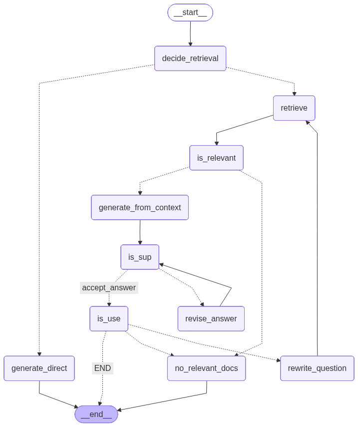

# ⬡ Nexa Verify — Self-Reflective & Self-Corrective RAG Agent

**Nexa Verify** is a stateful **Self-RAG / Corrective-RAG** application built with **LangGraph**, **LangChain**, **FAISS**, and **Streamlit**. Instead of blindly trusting a single retrieval and generation pass, the agent actively decides whether retrieval is necessary, grades retrieved document chunks for relevance, verifies that every claim in its answer is grounded in source text, revises unsupported claims into strict quote-backed responses, evaluates answer usefulness, rewrites search queries when needed, and persists multi-turn conversation state using an in-memory LangGraph checkpointer.

---

**Live Demo** - https://nexaai-self-reflective-rag-glmifbsngbbvfkpbd4ygjz.streamlit.app/

## ✨ Key Features

### 🧠 Self-Corrective LangGraph Pipeline (`self_rag_backend.py`)
- **Adaptive Retrieval Gate (`decide_retrieval`):** Classifies incoming queries using structured `TypedDict` outputs (`RetrieveDecision`) to route general-knowledge or conversational-history questions to **Direct Mode** and document-dependent questions to **Retrieval Mode**.
- **Dynamic User PDF Ingestion (`load_documents` & `build_vector_store`):** Accepts local PDF paths, directories of `.pdf` files, or uploaded file-like objects via `PyPDFLoader`, splits them with `RecursiveCharacterTextSplitter` (`chunk_size=600`, `chunk_overlap=150`), embeds chunks locally with `sentence-transformers/all-MiniLM-L6-v2`, and builds an in-memory **FAISS** vector index.
- **Chunk Relevance Grading (`is_relevant`):** Evaluates each retrieved candidate chunk individually (`RelevanceDecision`) and discards irrelevant passages before generation.
- **Support Verification & Revision Loop (`is_sup` ↔ `revise_answer`):**
  - Strictly grades whether the generated answer is `fully_supported`, `partially_supported`, or `no_support` against the retrieved context (`IsSUPDecision`) and extracts up to 3 verbatim supporting quotes (`evidence`).
  - Automatically triggers `revise_answer` (up to `MAX_RETRIES = 8`) to rewrite unsupported or interpretive phrasing into strict bullet-pointed direct quotes from the context.
- **Usefulness Verification & Query Rewriting (`is_use` → `rewrite_question`):**
  - Verifies that the grounded answer actually addresses the user's question (`IsUSEDecision`: `useful` vs `not_useful` with `use_reason`).
  - When `not_useful`, rewrites a search-optimized 6–16 word `retrieval_query` (`RewriteDecision`) and loops back to FAISS retrieval (up to `MAX_REWRITE_TRIES = 3`).
- **Multi-Turn Conversation Memory (`InMemorySaver`):** Compiled with LangGraph's `InMemorySaver` checkpointer and `add_messages` state reducer so follow-up questions retain conversation history within each `thread_id`.

### 🖥️ Interactive Streamlit Workspace (`app.py`)
- **Knowledge Base Manager:** Upload one or multiple PDFs with automatic indexing, live **Files / Pages / Chunks** metrics, **Re-index** & **Clear KB** controls, and an optional **Load Workspace PDFs** picker for local `.pdf` files.
- **Live Streaming Pipeline Feed:** Streams `app.stream(..., stream_mode="updates")` inside `st.status`, showing every graph node executed in real time along with per-step latency.
- **Verification Badges & Controls:** Displays `RAG VERIFIED` / `DIRECT MODE`, grounding badges (`Fully Supported`, `Partially Supported`, `No Support`), retry/step counts, starter prompt buttons, **Re-run Last**, **Reset Chat** (rotates `thread_id`), and **Export Report (`nexa_verify_report.md`)**.
- **3-Tab Agent Inspector:**
  - **🧭 Pipeline Trace:** Entry routing decision, `IsSUP` & `IsUSE` verdicts, `use_reason`, rewritten query, and node-by-node execution timeline.
  - **🔍 Evidence & Chunks:** Verbatim `IsSUP` supporting quotes, relevant chunks used (with source filename and page number), and filtered-out chunks.
  - **🧪 Vector Search Sandbox:** Query the active FAISS index directly without making LLM calls, controlled by the sidebar **Top-K Retrieved Chunks** slider (`1–10`).

---

## 🏗️ Architecture & Workflow



---

## 🛠️ Tech Stack

| Layer | Technology |
| :--- | :--- |
| **Workflow & State Graph** | `langgraph` (`StateGraph`, `InMemorySaver`, `add_messages`) |
| **LLM Integration** | `langchain-groq` (`ChatGroq`, default `openai/gpt-oss-120b` via `GROQ_MODEL`) |
| **Structured Outputs** | LangChain `with_structured_output` with Python `TypedDict` + `Annotated` schemas |
| **Embeddings** | `HuggingFaceEmbeddings` (`sentence-transformers/all-MiniLM-L6-v2`) |
| **Vector Database** | `FAISS` (`faiss-cpu`) |
| **PDF Parsing & Chunking** | `PyPDFLoader` (`pypdf`) + `RecursiveCharacterTextSplitter` |
| **Frontend UI** | `Streamlit` |
| **Containerization** | `Docker` (`python:3.10-slim`, port `7860`) |

---

## 📂 Project Structure

```text
Nexa-verify-self-corrective-rag/
├── app.py                   # Interactive Streamlit frontend & 3-tab verification inspector
├── app.png                  # LangGraph compiled Self-RAG workflow diagram
├── self_rag_backend.py      # LangGraph Self-RAG backend, FAISS indexing, & InMemorySaver
├── Dockerfile               # Container build for port 7860 (Hugging Face Spaces / Docker)
├── requirements.txt         # Python dependencies
├── self_rag_web.ipynb       # Exploratory / experimentation notebook
├── Company_Policies.pdf     # Sample PDF document (optional workspace load)
├── Company_Profile.pdf      # Sample PDF document (optional workspace load)
├── Product_and_Pricing.pdf  # Sample PDF document (optional workspace load)
├── .gitignore               # Excludes .env, venv/, uploaded_docs/, and caches
├── .gitattributes           # Git LFS patterns for binary artifacts
└── README.md                # Project documentation
```

---

## ⚙️ Configuration & Environment Variables

Create a `.env` file in the project root (already ignored by `.gitignore`):

```env
GROQ_API_KEY=your_groq_api_key_here
# Optional: override the default Groq model (defaults to openai/gpt-oss-120b)
GROQ_MODEL=openai/gpt-oss-120b

# Optional: required only if switching self_rag_backend.py back to HuggingFaceEndpoint
HuggingFace_API_KEY=your_huggingface_token_here
```

> [!NOTE]
> Ensure `langchain-groq` is installed in your environment alongside the packages listed in `requirements.txt`, as `self_rag_backend.py` uses `ChatGroq` as its active LLM backend.

---

## 🚀 Getting Started (Local Setup)

### 1. Clone the Repository
```bash
git clone https://github.com/Anvesh-Vishwakarma/NexaAI-Self-Reflective-RAG.git
cd NexaAI-Self-Reflective-RAG
```

### 2. Create a Virtual Environment & Install Dependencies

**Windows (PowerShell):**
```powershell
python -m venv venv
.\venv\Scripts\Activate.ps1
pip install -r requirements.txt
pip install langchain-groq
```

**macOS / Linux:**
```bash
python3 -m venv venv
source venv/bin/activate
pip install -r requirements.txt
pip install langchain-groq
```

### 3. Run the Application
```bash
streamlit run app.py
```
*(On Windows, if you ever move/rename the virtual environment folder, run `python -m streamlit run app.py`.)*

---

## 🐳 Docker Deployment

The included `Dockerfile` uses `python:3.10-slim`, creates a non-root user (`UID 1000`), and exposes Streamlit on port `7860` (compatible with Hugging Face Spaces Docker SDK):

```bash
# Build the image
docker build -t nexa-verify-rag .

# Run the container with your .env file
docker run -p 7860:7860 --env-file .env nexa-verify-rag
```

Then open `http://localhost:7860` in your browser.

---

## 🧩 Programmatic Backend Usage

You can also use `self_rag_backend.py` directly in Python scripts or notebooks:

```python
from self_rag_backend import app, build_vector_store, load_documents

# 1. Load user-provided PDFs (file paths, folder paths, or file-like objects)
docs = load_documents(["Company_Policies.pdf", "Product_and_Pricing.pdf"])

# 2. Chunk, embed, and build the FAISS vector store
build_vector_store(docs)

# 3. Query the Self-RAG graph with a persistent thread_id
config = {"configurable": {"thread_id": "session-1"}}

res1 = app.invoke({"question": "What is the refund policy?"}, config=config)
print(res1["answer"])
print("Grounding:", res1.get("issup"), "| Evidence:", res1.get("evidence"))

# 4. Follow-up query on the same thread remembers prior turns via InMemorySaver
res2 = app.invoke({"question": "Summarize what I just asked in one line."}, config=config)
print(res2["answer"])
```
